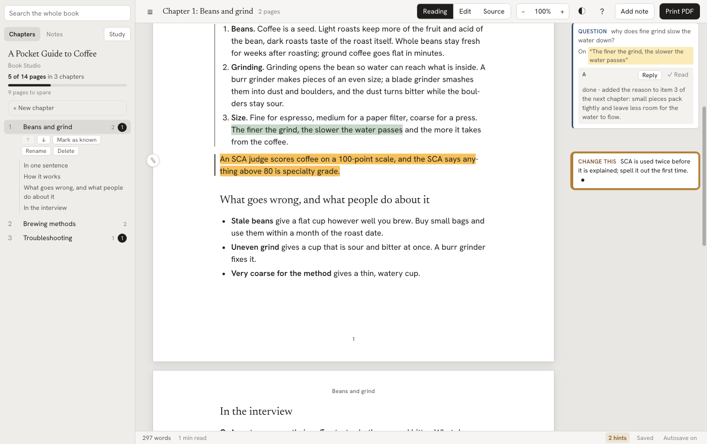
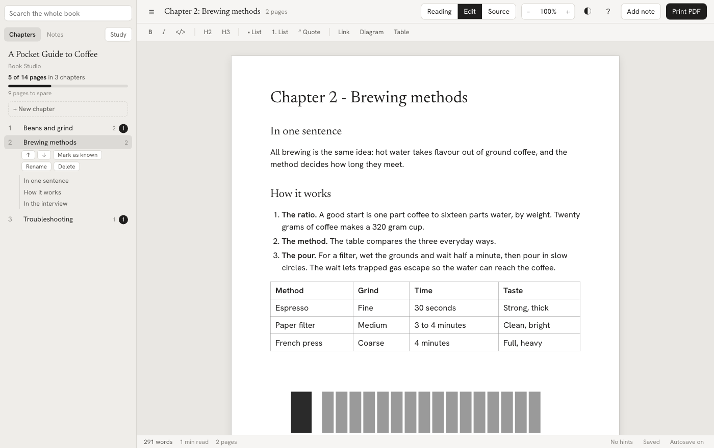
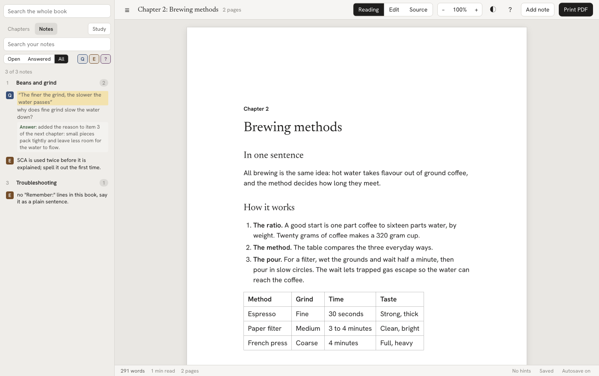
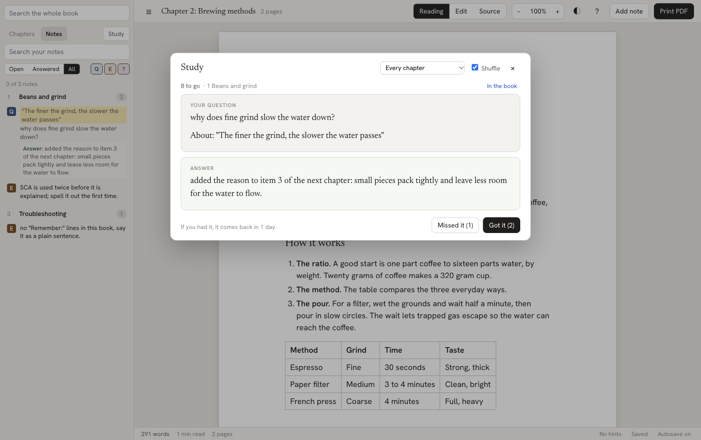
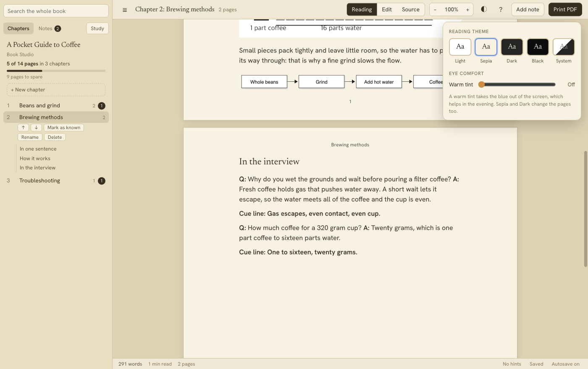

<h1 align="center">Book Studio</h1>

<p align="center">
  <b>Write, read, annotate and print a book written in markdown.</b><br>
  Free and open source. Works offline. No accounts, no subscriptions, nothing to buy.
</p>

<p align="center">
  <a href="LICENSE">MIT licence</a> ·
  <a href="#install">Install</a> ·
  <a href="#try-it-in-two-minutes">Try it</a> ·
  <a href="#using-book-studio-with-claude">Use it with Claude</a> ·
  <a href="THIRD_PARTY_LICENSES.md">Third-party licences</a>
</p>

<p align="center"></p>

Book Studio is a desktop app (macOS, Windows, Linux) for people who write a book as a folder of markdown files and want to
*read it like a book*: the chapter laid out in real printed pages, the same ones that come out in the PDF. You can edit it right on
the page, leave notes for yourself (or for an AI assistant) in the margin, check that the PDF is clean, and export it as an EPUB or
a single web page.

It keeps everything in plain markdown files in a folder you own. There is no cloud, no database and no lock-in: stop using Book Studio
tomorrow and you still have a folder of readable `.md` files.

## What it does

| | |
| --- | --- |
| **Three views of one chapter** | *Reading*: the chapter as printed pages. *Edit*: the page itself, edited directly (type, make words bold, start a list with `- `); the markdown is written behind the scenes. *Source*: the markdown, in a code editor. A change in one is in the others. |
| **Your files stay yours** | Only the paragraph, list or table you changed is rewritten. A chapter you merely open is saved byte for byte as it was. |
| **Notes in the margin** | Select words, press a key, and leave a question, a change request or a "this lost me" note. They live inside the markdown as comments, and show as cards in the margin. [Claude Code](#using-book-studio-with-claude) (or any assistant, or you) answers them. |
| **A print-ready PDF with checks** | A4, one typeface system, hairline rules, black and white. After printing, Book Studio reads the PDF back and tells you what is wrong: lost text, stranded headings, split code, pages that end half empty, colour. |
| **Search the whole book** | Every chapter at once, with the sentences shown, and a notes inbox for every open question. |
| **Page limit** | Set one (`pages: 126`) and watch "114 of 126 pages" with a bar. Mark chapters you know as *known* to leave them out of the PDF. |
| **Writing hints** | Your own rules ("never write `Remember:`") and acronyms used before they are explained, underlined as you write. |
| **Study mode** | Turns the `**Q:** ... **A:** ...` answers in your chapters into flashcards that come back at growing intervals. |
| **Pictures and diagrams** | Paste a picture, or write a [Mermaid](https://mermaid.js.org) diagram as text. Both print in grey, like the rest of the book. |
| **Export** | PDF, EPUB, one self-contained web page, or each chapter as its own PDF. |
| **Reading themes** | Light, Sepia, Dark, Black, or follow the system, plus a warm tint for the evening. |
| **Version history, autosave, chapters** | Every save keeps a version outside your book folder; new, rename, move and delete chapters with links kept working. |

<p align="center">
  
  
</p>
<p align="center">
  
  
</p>

## Install

Download the installer for your system from the [Releases](https://github.com/tlacerdap/book-studio/releases) page (macOS `.dmg`,
Windows `.exe`, Linux `.AppImage` or `.deb`), or [build it yourself](#build-from-source). The installers are **not code-signed**
(a signing certificate is a paid service, and Book Studio has none), so your system warns once on first launch:

- **macOS:** open the `.dmg`, drag Book Studio to Applications, then right-click the app and choose **Open**, and **Open** again.
  If macOS says the app "is damaged", run `xattr -dr com.apple.quarantine "/Applications/Book Studio.app"` once.
- **Windows:** if SmartScreen says "Windows protected your PC", click **More info**, then **Run anyway**.
- **Linux:** `chmod +x Book-Studio-*.AppImage && ./Book-Studio-*.AppImage`, or `sudo apt install ./Book-Studio-*.deb`.

Nothing is sent anywhere. The app works without a network connection and has no telemetry, update checker or account.

### Build from source

You need Node.js 22.12 or newer.

```bash
git clone https://github.com/tlacerdap/book-studio.git
cd book-studio
npm install
npm start            # builds and opens the app
npm test             # the automated tests
npm run dist         # installers for this machine, into release/
```

## Try it in two minutes

Open the app, choose **File > Open Book Folder...** and pick [`examples/sample-book`](examples/sample-book). It is a three-chapter
pocket guide to coffee that uses every feature: notes (one answered, one open), a table, a picture, a diagram, flashcards, a page
limit and a writing rule. Click a paragraph in the Reading view, press the pencil, and edit it. Press **Print PDF** to see the checks.

Your own book is any folder with a `book.yaml` and your chapters:

```
my-book/
  book.yaml
  chapters/
    01-first-chapter.md
    02-second-chapter.md
  images/            (made for you when you paste a picture)
```

```yaml
# book.yaml
title: "My Book"
author: "Your Name"
chapters: chapters/*.md      # ordered by file name
pages: 120                   # optional page limit
```

Each chapter starts with `# Chapter 1 - Title`. That is all Book Studio needs; the full list of settings is in [book.yaml](#bookyaml).
If you open a folder that has chapters but no `book.yaml`, the app offers to create one. It never writes one into a folder that does not
look like a book.

## Using Book Studio with Claude

Book Studio does not talk to any AI service and needs no API key. It is built so that **you read and edit in the app, and an AI
coding assistant such as [Claude Code](https://claude.com/claude-code) edits the same markdown files from the terminal**. The two never
step on each other: Book Studio watches the folder, and when Claude changes a chapter it reloads on screen. (If you have unsaved edits
at that moment, it asks which version to keep.)

The bridge between you and the assistant is the **notes protocol**, which is just comments in the markdown:

```markdown
Coffee is a seed. Light roasts keep more of the fruit and acid of the bean.
<!-- Q: why does light roast taste sour? [on: "fruit and acid"] -->
<!-- A: done - added a sentence explaining that acid is strongest before long roasting breaks it down. -->
```

| Note | You press | Means |
| --- | --- | --- |
| `<!-- Q: ... -->` | **Q** | A question: "I do not understand this". The assistant rewrites the text so you would not have to ask. |
| `<!-- E: ... -->` | **E** | A change request: "change this". |
| `<!-- ? -->` | **?** | "This lost me", with no words. The assistant makes it clearer. |
| `<!-- A: ... -->` | (the assistant) | The answer, written under your note. |

### The workflow

1. **Read** the chapter in Book Studio. When something is unclear, **select the exact words** and press `Q`, `E` or `?`, type a line,
   press Enter. The words you selected are saved with the note (`[on: "..."]`), so the assistant knows precisely what you meant.
2. **Ask Claude Code** to deal with them. The `?` button in the toolbar copies the exact sentence to paste, for example
   `process notes in chapter 03`. Claude reads the chapter, rewrites the text, and writes an `A` under each note saying what it changed.
3. **Read the answers** in the margin. Not happy? Press **Reply** and write a follow-up. Happy? Press **Read**, which removes the note
   and its answer.
4. Repeat. A note with no answer under it is one that has not been processed yet, so you can always see what is still open (the badge on
   each chapter, and the **Notes** tab).

### Setting Claude Code up for your book

Put a `CLAUDE.md` file in your book's folder. Claude Code reads it at the start of every session. Start from
[`examples/sample-book/CLAUDE.md`](examples/sample-book/CLAUDE.md): it describes the protocol above, tells Claude how to process notes
("answer every note, never delete one without an answer, do not reformat lines you did not need to change"), and has a place for
your own rules about the book (the page limit, the voice, the shape of a chapter). Then, in the book's folder:

```bash
claude                     # start Claude Code in your book's folder
> process notes in chapter 03
```

Tips from using it this way:

- **Do not edit a chapter in Book Studio while Claude Code is rewriting that same chapter.** Autosave never overwrites a file that changed
  on disk without asking, but two writers on one file is still confusing. Let Claude finish, then read.
- **Keep your rules in `CLAUDE.md` and in `book.yaml`** (`pages`, `rules`, `terms`). The app shows the same rules as underlined hints
  as you write, so you and the assistant are held to the same standard.
- The checks on the printed PDF (lost text, stranded headings, colour) are a good "did the assistant break anything?" test after a big
  edit: press **Print PDF**.
- Any assistant that can edit files works the same way, because the protocol is plain text. Claude Code is the one this was built with.

### Let the assistant read along (optional MCP server)

By default Claude Code reads your book the same way you would — by opening the markdown files. If you would rather it always
know *what you are looking at right now* — the open chapter, the heading you are on, the words you have selected — Book Studio can
expose that over [MCP](https://modelcontextprotocol.io). It is **off unless you ask for it**, serves **only your own machine**
(`127.0.0.1`), and is **read-only**: it answers questions about the open book and never writes.

Start the app with the `BOOK_STUDIO_MCP` flag set, then point Claude Code at it once:

```bash
# Start Book Studio with the reader server on (any value turns it on; the port defaults to 4319).
#   macOS / Linux:
BOOK_STUDIO_MCP=1 open -a "Book Studio"      # or: BOOK_STUDIO_MCP=1 ./Book\ Studio
#   Windows (PowerShell):
$env:BOOK_STUDIO_MCP=1; & "$env:LOCALAPPDATA\Programs\book-studio\Book Studio.exe"

# Then register it with Claude Code (once):
claude mcp add --transport http book-studio http://127.0.0.1:4319/
```

It offers five read-only tools: `reading_now` (the chapter, view, heading and selection you are on), `current_book` (title,
author and the chapter list), `chapter_text` (one chapter's markdown, with or without your notes), `book_notes` (every question
and change request you have left) and `search_book`. Ask Claude things like *"explain the part I'm reading"* or *"answer the notes
in the chapter I'm on"* and it starts from where you actually are. Set `BOOK_STUDIO_MCP_PORT` to use a port other than 4319.

*Book Studio is an independent open-source project. It is not made by, affiliated with or endorsed by Anthropic. "Claude" and
"Claude Code" are Anthropic's names; using Claude Code needs your own Anthropic account, which is separate from Book Studio.*

## Open source, and what is in it

Book Studio is released under the [MIT licence](LICENSE). Everything it contains is free to use and redistribute:

- the app and its code (MIT);
- the typefaces *Newsreader*, *Hanken Grotesk* and *JetBrains Mono* (SIL Open Font License, which also allows embedding them in the
  documents you make);
- open-source libraries (Electron, markdown-it, Paged.js, ProseMirror, CodeMirror, Mermaid, pdf.js and others), all under permissive licences.
  [`THIRD_PARTY_LICENSES.md`](THIRD_PARTY_LICENSES.md) lists every package with its licence text, made by `npm run notices`.

There are no paid components, no API keys, no tracking, and nothing is downloaded when you run it. The only non-free step in a normal
software release, code-signing the installers, is left out on purpose, which is why you see the first-launch warning above.

Contributions are welcome: see [CONTRIBUTING.md](CONTRIBUTING.md).

---

# Reference

Everything below is the detailed reference for the app, the command line, `book.yaml`, the checks and the styles.

Pipeline: markdown-it (markdown to HTML), Paged.js (pagination), Chromium's `printToPDF` through Electron (PDF), pdf.js (the checker).
Book Studio holds all the code, fonts and CSS; the book folder holds only the writing.

## The app

```bash
npm run build && npm run app      # or: npm start
```

Open a book folder (File > Open Book Folder, or Open Recent). A folder is a book if it has a `book.yaml`. If it has
none, the app offers to create one only when the folder visibly holds a book (a `chapters` folder with markdown files
that start with a heading, or at least two numbered ones like `01-intro.md`); otherwise it writes nothing and says so. The folder is watched: a chapter changed outside the app (by Claude Code, say)
reloads silently, or, if you have unsaved edits, a banner asks Reload or Keep mine.

- **Left panel:** Parts and chapters, the open chapter's H2/H3 outline, a badge with its count of open notes, and how long the book is: pages per chapter and a total. The count comes from laying every chapter out quietly in the background (about 20 seconds the first time, remembered after that) and matches the numbered pages of the PDF; the PDF also has a cover and the contents.
- **Sideways scrolling:** the reading view scrolls sideways only when the page itself is wider than the window. Otherwise the page is centred, and the notes use the room beside it (narrowing, or sitting over the page's blank right margin, when room is short). Fit (`9`) shows the whole page with room for the notes.
- **Search:** the box at the top of the left panel searches every chapter at once (`Shift+F` puts the cursor there). It lists the chapters that have the words, how many times, and under each the sentences with the words marked, the section they are in and the line of the file. Click one, or move through them with the arrow keys (Enter goes to the next, Shift+Enter back), and that chapter opens at that spot with every occurrence marked and the find bar ready for Next and Previous. Esc clears the search and brings the chapter list back. It searches what the page shows (not the markdown marks, the notes or the link addresses) and ignores capitals and curly versus straight quotes; the chapter title counts too. In the source view the same results select the words in the markdown.
- **Reading view:** the chapter laid out exactly as it prints (same styles, same pagination rules). Read only; click a
  block, or select text, then add a note. Blocks with notes get a thin rule on their left; notes are cards in the margin.
- **Editing:** three views. *Reading* is the chapter laid out in printed pages, with your notes. *Edit* is the same chapter as one long page in the book's own fonts and sizes, and you edit it directly: type, make words bold, start a list with `- `, a heading with `## `, add a link or a table. What you type is written to the file as proper markdown, and only the paragraph, list or table you changed is rewritten (an untouched chapter is saved byte for byte as it was, and a note stays where it was). *Source* is the whole chapter as markdown. The three show the same text, so a change in one is there in the others; the pencil beside a clicked paragraph in Reading opens that paragraph in Edit. In Edit the page does not break into printed pages (that engine cannot be typed into): see the page breaks in Reading. Notes show as small labels and are written in Reading; anything the editor has no picture of (footnotes, raw HTML) is shown boxed and kept exactly as written, to be changed in Source. Pictures can be pasted or dropped. Formatting has keys and a bar: Bold `B`, Italic `I`, Code `Alt+C`, Section heading `2`, Subheading `3`, Bulleted list `Shift+8`, Numbered list `Shift+7`, Quote `Shift+.`, Link `L`, and Table, Diagram and Picture from the Format menu; typing `**words**`, `*words*` or `` `words` `` also works. The editor is ProseMirror; the Source view is CodeMirror with the system's spell check (so macOS Writing Tools work in both). A line that is wrapped over several lines in the file keeps its line breaks.
- **Saving and history:** a chapter saves itself a moment after you stop typing ("Autosave on" in the status bar turns it off). It never writes over a file that someone else (Claude Code, another editor) changed since you opened it: it shows the banner instead. Every save keeps a version in the app's data folder, not in the book (File > Version History, `Shift+H`): pick one to see the lines that differ from your text now and restore it; the version it replaces stays in the history. The status bar shows words, reading time and the chapter's pages.
- **Chapters:** File > New Chapter (`N`) makes the next numbered file with its title. The open chapter has buttons under it in the left panel: move up or down (the two chapters trade file numbers, and the "Chapter N" in their titles when both have one), rename (the file name; links from other chapters follow) and delete (to the Trash, after warning which chapters link to it). Parts come from the book's index file, which the app does not edit. `K` opens a quick "go to" box for any chapter or heading of the book.
- **Page limit and known chapters:** click the length in the left panel to set a page limit (`pages:` in book.yaml). The panel shows "114 of 126 pages", a bar and how many pages are to spare or over. *Mark as known* (under the open chapter) keeps the file but leaves it out of the PDF, the exports, the page total and the flashcards; `known:` in book.yaml lists them.
- **Writing hints:** the status bar counts things worth a look in the chapter; click it for the list (each line opens the place), or check the whole book. Two kinds: the book's own `rules` (words that must not appear, with the reason you wrote) and acronyms used twice or more before they are explained (explained means `Full name (ABC)`, `ABC (full name)`, `ABC stands for` or bold). *Ignore* on a term adds it to `terms:`. The words are underlined in the editor.
- **Notes inbox:** the Notes tab of the left panel lists every question, change request and "lost me" of the book: open, answered or all, by kind, or by words. Click one and the chapter opens at its paragraph.
- **Study:** the Study button (`Alt+S`) makes flashcards from the chapters' `**Q:** ... **A:** ...` interview answers (with their cue line as the hint), their numbered drill lines (`- **1. Question?** answer`) and your own questions that Claude answered. Say the answer, reveal it, then mark *Missed it* or *Got it*: a missed card comes back in the same session, a known one after 1, 3, 7, 16 and 35 days. Progress is kept on this computer. Known chapters are left out.
- **Pictures and diagrams:** paste or drop a picture on the text, or Format > Insert Picture. It is copied into `images/` in the book and the chapter gets ``. In print, pictures are grey (the book is monochrome) and kept on one page; web addresses are never fetched. A fenced block with the word `mermaid` after the backticks is drawn as a diagram (flowchart, sequence, and the other [mermaid](https://mermaid.js.org) kinds), in grey, once, and kept; a mistake in it shows as a note in its place. The command-line `pdf` leaves diagrams out; the app draws them.
- **Export** (File > Export): the book as an EPUB; as one web page that holds its own fonts and pictures; one chapter as a PDF; every chapter as its own PDF. Known chapters are left out of the book exports. The EPUB has been checked as well-formed XML with a working contents, not with a store's validator.
- **Focus mode** (`Alt+F`) shows only the text, in a narrow column; Esc comes back. **Appearance** (the half-moon button in the toolbar, or View > Appearance): Light (the default, white), Sepia (warm paper, brown ink), Dark, Black, or follow the system. The theme restyles the app and the pages in Reading and Edit; the printed PDF is always black on white. **Eye Comfort** adds a warm tint over the whole window (off, or up to 35%), which takes the blue out of the screen in the evening. Both choices are remembered.
- **Print PDF:** saves, builds `build/<output>.pdf`, runs the checker, shows a report whose lines open the chapter
  they belong to, then opens the PDF in your viewer.

| Keys (Cmd on macOS, Ctrl elsewhere) | |
| --- | --- |
| `/` | switch between Reading and Source |
| `E` | open the clicked paragraph in the Edit view |
| `Alt+1`, `Alt+2`, `Alt+3` | Reading, Edit, Source |
| `N` | new chapter |
| `K` | go to a chapter or heading |
| `Shift+H` | version history |
| `Alt+S` | study flashcards |
| `Alt+F` | focus mode |
| `S` | save |
| `Shift+M` | add a note to the selected block |
| `\` | show or hide the left panel |
| `F` | find in the chapter: every occurrence is marked, "3 of 12", Enter for the next, Shift+Enter for the one before |
| `Shift+F` | search the whole book |
| `[` and `]` | previous and next chapter |
| `P` | print PDF |
| `O` | open a book folder |
| `=` and `-` | zoom the page in and out (the text size in the source view) |
| `0` | actual size |
| `9` | fit the page to the window |

**Notes** are kept in the markdown, one comment on its own line directly after the block: `<!-- Q: ... -->` a question,
`<!-- E: ... -->` an edit request, `<!-- ? -->` confused, `<!-- A: ... -->` an answer written by Claude Code. The
Obsidian forms (`%%Q: ...%%`, `%%?%%`) work the same. Adding, editing or removing a note changes only its own lines and
never reformats anything else; files are written atomically. In the reading view pick Question (Q), Change this (E) or Lost me (?), type,
press Enter. The keys Q, E and ? (capital or not) pick the kind even while the page has the keyboard; while typing, Ctrl or Cmd with 1, 2, 3 does the same. The box opens next to the words you selected (or the place you clicked), keeps what you typed if the window is redrawn, and the words or block a note is about stay highlighted until you press Read. The `?` button in the toolbar explains this and copies the command to give Claude Code (`process notes in chapter NN`). Select exact words first and the note carries them as `[on: "..."]`, shown highlighted on the page, so Claude Code knows what to change. A selection of more than 200 characters (it may run over several paragraphs) is saved as its first and last words with ` ... ` between them, and the whole stretch is highlighted. Click highlighted text to see its note: the card is outlined and brought into view, and its words are marked strongest. An answer shows under its note; **Reply** writes a follow-up note under it, and **Read** removes the note and its answer.
`CLAUDE.md` in the book repo tells Claude Code how to process them.

**Safety.** The window is sandboxed, with context isolation, no Node, a strict content security policy and a narrow
preload bridge (`app/shared/api.ts` lists every call). It loads only its own files, the shared styles and the prepared
pages; the network is blocked outright. Links in the book open in your own browser.

## Building the installers

Every installer that is handed out should have its own version (`npm version patch --no-git-tag-version`, or `minor` for features), so
an installed copy can always be told apart from the one before: the version is in the `?` popover, on the welcome screen and in the About box.

| System | File | Built with |
| --- | --- | --- |
| macOS | `Book-Studio-<version>-mac-arm64.dmg` and `-mac-x64.dmg` | electron-builder |
| Windows | `Book-Studio-<version>-win-x64.exe` (NSIS installer) | electron-builder |
| Linux | `Book-Studio-<version>-linux-x86_64.AppImage` and `Book-Studio-<version>-linux-amd64.deb` | electron-builder |

```bash
npm run dist          # everything this machine can build, into release/
npx electron-builder --mac --publish never      # or --win, or --linux
npm run pack          # an unpacked app in release/mac-arm64/ (or similar), quick to test
npm run notices       # regenerate THIRD_PARTY_LICENSES.md after changing dependencies
```

`electron-builder.yml` holds the settings. A macOS build holds both Mac architectures, so it needs the native canvas
module (used by the checker's ink and colour checks) for both: `npm install --no-save --force
@napi-rs/canvas-darwin-x64@0.1.100 @napi-rs/canvas-darwin-arm64@0.1.100` before building on a Mac. The `.deb` needs a
Linux machine (its packaging tool fails on macOS); the other installers build anywhere. The icon is `assets/icon.png`,
drawn by `npm run icon`. The installers are unsigned on purpose (see [Install](#install)). The AppImage starts Chromium without its
process sandbox (an AppImage cannot carry the helper it needs); the window keeps its own sandbox, context isolation and content
security policy.

## Layout

```
core/       shared by the command line and the app
            config (book.yaml), mdrender (markdown), book (chapters, Parts), html, notes, check, lint,
            pdf (spawns Electron); browser/ holds the pagination rules that run inside the hidden window
electron/   the hidden-window PDF renderer
app/        the desktop app: main/ (windows, menu, files, print), preload/, renderer/ (the UI), shared/
bin/        the `book-studio` command
scripts/    build script
styles/     book.css, paged.css and fonts/: the typography shared by the app view and the PDF
tests/      vitest
```

A **book** is any folder that contains a `book.yaml`. Nothing in the app is specific to one book (the optional `lint` command is the one exception, see below).

## Setup

Node 22.12 or newer.

```bash
npm install            # downloads Electron
npm run build          # bundles dist/
npm test
npm run app            # starts the desktop app
```

## Command line

```bash
npx book-studio pdf   /path/to/book                    # build/<output>.pdf in the book folder
npx book-studio pdf   /path/to/book --chapters 0-3     # quick preview: numbers, ranges, commas or file names
npx book-studio pdf   /path/to/book --check            # build, then run the checker (exit 1 on failures)
npx book-studio pdf   /path/to/book --out /tmp/x.pdf --html /tmp/x.html --extra-css try.css
npx book-studio check /path/to/book                    # checks build/<output>.pdf
npx book-studio check /path/to/book --samples /tmp/pages   # also write PNGs of sample pages
npx book-studio lint  /path/to/book                    # optional: a chapter lint written for the author's own style guide (needs a PROGRESS.md); most books will not use it
```

Run it from this folder, or by path (`node /path/to/book-studio/bin/book-studio.js ...`). Exit status is 0 on success
and 1 if a check fails, so Claude Code can build and check without the app. Developer aids: `--trace` logs pagination
decisions and `--no-rules` runs Paged.js without the book's pagination rules.

## book.yaml

```yaml
title: My Book                     # required
subtitle: A subtitle
author: Your Name
date: November 1, 2026             # printed on the cover as written
language: en                       # document language and hyphenation
chapters: chapters/*.md            # glob; chapters are ordered by file name
output: my-book                    # the PDF is build/my-book.pdf
index: INDEX.md                    # optional: groups chapters into Parts (see below)
pages: 126                         # optional: the page limit; the left panel shows how far you are
known: [02-ch02-python.md]         # optional: chapters kept in the folder but left out of the PDF (the app edits this)
terms: [MCP, RAG]                  # optional: words the reader knows, so the writing hints do not ask about them
rules:                             # optional: words that must not appear; shown as writing hints
  - "C#"
  - forbid: "^Remember:"
    regex: true
    message: No Remember sections
```

Unknown keys are rejected, so a typo cannot pass silently. The app changes `pages`, `known` and `terms` for you and keeps your comments; it never creates a book.yaml. A chapter file starts with `# Chapter N - Title`
(or `# Appendix A - Title`); that line becomes the opening-page label and title. A line under it of the form
`Level: [B] | Priority: [Core]` becomes the small level line. Chapter numbers for `--chapters` and for Parts
are the leading digits of the file name.

**Parts.** If `index` names a markdown file, its `## Part I - Name` headings and `**Chapter 3 - Title**` lines
decide which chapters belong to which Part. A Part appears above the title on the opening page of its first
chapter and as a line in the contents; it has no page of its own, so the first chapter is page 1.

**Missing chapters.** Links to chapter files that are not in this build print as plain text.

## Per-book style overrides

Without a `book.css` in the book folder, the book uses `styles/book.css`. A book may add its own `book.css`
next to its `book.yaml`; it is layered after the default, so it can change any custom property or rule
without repeating the fonts. Relative `url(...)` values in it resolve against `styles/`.

## What the checker verifies

`book-studio check` exits non-zero if any of these fail:

- a page ends with a heading, or a heading has fewer than 3 lines after it on the same page
- a page starts or ends with fewer than 3 lines of a paragraph that continues across the break
- a code block is split with fewer than 4 visible lines on one side, or a short block is split
- a sentence that introduces a list or code block is stranded at the bottom of a page
- a list item is split across pages
- contents page numbers differ from the real chapter start pages (checked against both the PDF
  bookmarks and the number printed in the footer of the chapter's first page)
- em or en dashes appear that are not in the source, or any colour appears on any page

It also reports the measure (characters per line), pages that end mostly empty, and the darkest pages.
The PDF has no structure, so lines are classified from the fonts the stylesheet assigns (see the docstring
in `core/check.ts`). A split code frame is told apart from two blocks that meet at a page break by the frame borders drawn on each page.

It also checks that every paragraph, list item and code line of the source is in the printed text, and that every contents entry matches the PDF bookmarks and footers.

## Tuning the look

Everything is a custom property at the top of `styles/book.css`. Change a value there and rebuild every book,
or put the change in one book's own `book.css` (see "Per-book style overrides").
The type scale and vertical rhythm come from measurements of the Claude Docs reference
(measured values supplied by the author; the reference PDF is not in this repo): 12pt body on an 18pt line,
H1 24/28.5 and H2 16.5 in a regular-weight serif, H3 13.5pt Semibold sans, 9.75pt byline.

| Variable | Controls |
| --- | --- |
| `--font-body`, `--font-heading`, `--font-mono`, `--font-ui` | Font stacks: body sans, heading serif, code, and header/footer/labels |
| `--size-body`, `--leading-body` | Body size and line height (12pt, 1.5 = 18pt) |
| `--size-h1`/`--leading-h1`, `--size-h2`/`--leading-h2`, `--size-h3`/`--leading-h3` | Heading sizes and line heights (h1 is the chapter title) |
| `--size-meta`, `--leading-meta`, `--size-small` | Chapter label and level line; running header, footer, captions |
| `--size-code`, `--leading-code`, `--size-inline-code` | Code blocks (10.5pt), inline code (relative to body) |
| `--weight-heading`, `--weight-strong` | 400 for headings (no bold headings), 600 for bold text |
| `--space-paragraph`, `--space-list-item` | Gap between blocks (7.5pt) and between list items (3pt) |
| `--space-h2-before/after`, `--space-h3-before/after` | Space around headings: tuned so block to H2 is 43.9pt and H2 to text is 30pt, baseline to baseline |
| `--space-code-before/after`, `--code-pad-y`, `--code-pad-x`, `--code-width` | Space around and inside code blocks; width of the frame, which reaches into the side margins |
| `--opener-top`, `--opener-label-after`, `--opener-title-after`, `--opener-meta-after` | Chapter opening page: 48pt from title to level line, 42pt from there to the first H2 |
| `--list-indent`, `--bullet-size`, `--bullet-left`, `--bullet-top` | List geometry: text indent 16.8pt, 3.75pt round bullet 3.8pt in, centred on the x-height |
| `--toc-label-width`, `--toc-number-width` | Contents columns |
| `--color-text`, `--color-meta`, `--color-secondary`, `--color-code-comment`, `--color-code-string`, `--color-rule`, `--color-code-border`, `--hairline` | All ink. Keep them dark enough to print crisply |
| `--margin-top`, `--margin-bottom`, `--margin-side` | Page margins, identical on every page. Vertical values are the reference's; the sides are wider for a 65 to 75 character measure |
| `--orphans`, `--widows` | Minimum paragraph lines at a page bottom or top |

The measure is set by body size, font and `--margin-side` together. The checker prints the current
median. If you change one, expect to change another to stay near 65 to 75 characters. If you change a
vertical-rhythm value, `book-studio check` does not verify it; compare baselines as described in "Checking the rhythm".

Constants in `core/mdrender.ts`: `SHORT_CODE_LINES` (code blocks up to this many visible lines never split,
default 15), `MIN_CODE_VISIBLE` (a split keeps this many visible lines on each side, default 4; the exact
`orphans`/`widows` for each block are computed from its content, so blank lines do not count), `CODE_COLUMNS`
(about how many characters fit across a code frame, used to estimate wrapped lines; 77 at 10.5pt in a 178mm
frame) and `SHORT_PARAGRAPH_CHARS` (a paragraph shorter than this directly after a heading is kept with
the block that follows it).

Code highlighting uses highlight.js token classes only. The monochrome treatment (bold keywords, grey
italic comments, dark-grey strings) is the `pre .hljs-*` rules in `styles/paged.css`.

## Adding or swapping fonts

1. Put the `.ttf` files and the licence file (`OFL.txt` or equivalent) in `styles/fonts/<family>/`.
   Open licences only, so the build stays reproducible and redistributable. Prefer static
   instances: if a font ships only as a variable file, instantiate the weights you need with `fonttools`
   and vendor those. Give each weight its own PostScript name, so the checker can tell weights apart.
2. Add one `@font-face` per weight and style at the top of `styles/book.css`, pointing at the files.
3. Point the matching `--font-*` variable at the new family name.
4. Rebuild, then run `book-studio check`. The checker reads the heading and code font families, the margins
   and the code and heading sizes back from the stylesheet's custom properties, so nothing needs to be kept
   in step by hand. It does need `--font-heading` and `--font-mono` to start with the real family name.

Bundled: Newsreader (headings, static instance at optical size 24), Hanken Grotesk (body: Regular, Italic,
Semibold), JetBrains Mono (code). All SIL OFL 1.1. Newsreader and Hanken Grotesk were chosen as the closest
open match to the reference's proprietary serif and sans, against Source Serif 4, Literata, Inter and Figtree.

Characters outside the bundled fonts (the Japanese strings in the tokenizer demo, for example) fall back
to whatever the machine has installed, so those few glyphs are not reproducible across machines. To make
them so, vendor a CJK font and add it to `--font-mono` and `--font-body`.

## Checking the rhythm

The spacing values were tuned against baseline-to-baseline distances measured from the reference:
18pt inside paragraphs and list items, 21pt between list items, 25.5pt from a paragraph to a list,
43.9pt from a block to an H2, 30pt from an H2 to its first line, 28.5pt inside the H1, 48pt from the H1
to the byline, 42pt from the byline to the first H2. To re-measure after a change, read the baseline
of each line from the PDF (pdf.js text items, or PyMuPDF `page.get_text("dict")`) and take differences between consecutive
lines of the kinds above.

## Pagination notes

- Paged.js lays pages out in a hidden Chromium window; `core/browser/rules.ts` adds what it lacks: widows and orphans,
  keep-with-next, short code blocks whole, code splits that keep four visible lines on each side, no page ending in
  half a hyphenated word. `orphans`, `widows` and `break-inside` are renamed to `--pg-*` properties before Chromium
  sees them, so Chromium's own fragmentation does not fight the rules.
- Page numbers are printed from labels the driver computes (cover none, contents roman, first chapter arabic 1),
  and the checker verifies each contents entry against the PDF bookmarks and the footers.
- Bookmarks come from headings: chapters, H2 and H3. Chromium cannot make a bookmark for a Part.
- Typographic quotes and ellipses are applied to text only. markdown-it's `replacements` rule is off
  on purpose: it would turn `--` and `---` into en and em dashes, and the book uses plain hyphens.
- Footnotes print as a list at the end of the chapter.

- A heading followed by an unsplittable element (a list item) too tall to share the page with it no longer ends up alone on a page: the element is split, between its inner items where it has them.
- A heading always keeps at least three lines of what follows it on its page; a heading followed by a single two-line list item moves to the next page with it.
