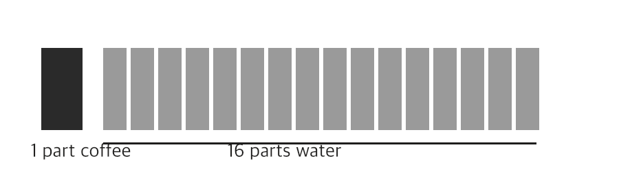

# Chapter 2 - Brewing methods

## In one sentence

All brewing is the same idea: hot water takes flavour out of ground coffee, and the method decides how long they meet.

## How it works

1. **The ratio.** A good start is one part coffee to sixteen parts water, by weight. Twenty grams of coffee makes a 320 gram cup.
2. **The method.** The table compares the three everyday ways.
3. **The pour.** For a filter, wet the grounds and wait half a minute, then pour in slow circles. The wait lets trapped gas escape so the water can reach the coffee.

| Method | Grind | Time | Taste |
| --- | --- | --- | --- |
| Espresso | Fine | 30 seconds | Strong, thick |
| Paper filter | Medium | 3 to 4 minutes | Clean, bright |
| French press | Coarse | 4 minutes | Full, heavy |

Small pieces pack tightly and leave little room, so the water has to push its way through: that is why a fine grind slows the flow.

## In the interview

**Q:** Why do you wet the grounds and wait before pouring a filter coffee?
**A:** Fresh coffee holds gas that pushes water away. A short wait lets it escape, so the water meets all of the coffee and the cup is even.

**Cue line: Gas escapes, even contact, even cup.**

**Q:** How much coffee for a 320 gram cup?
**A:** Twenty grams, which is one part coffee to sixteen parts water.

**Cue line: One to sixteen, twenty grams.**
